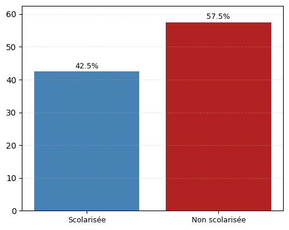
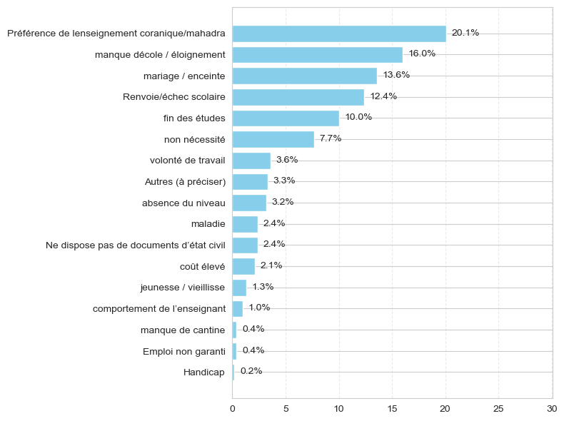
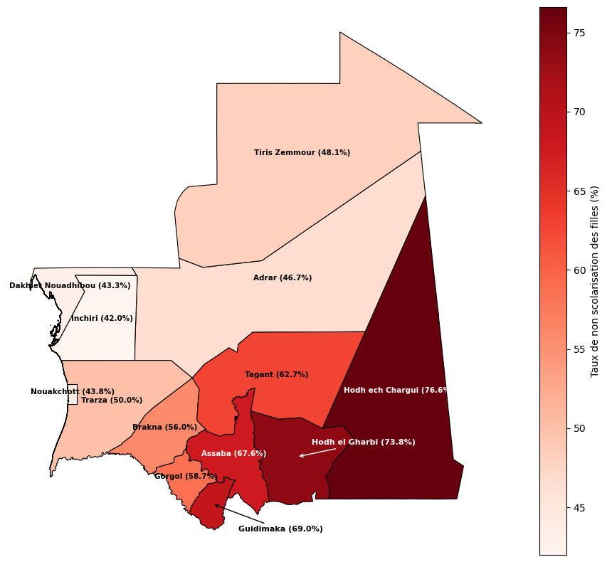
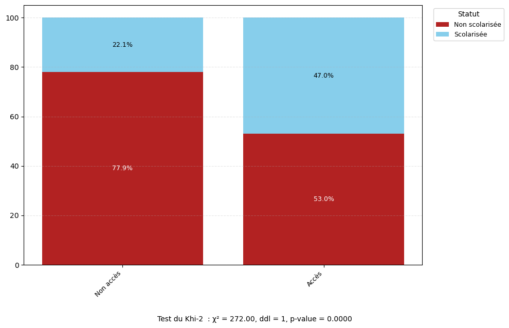
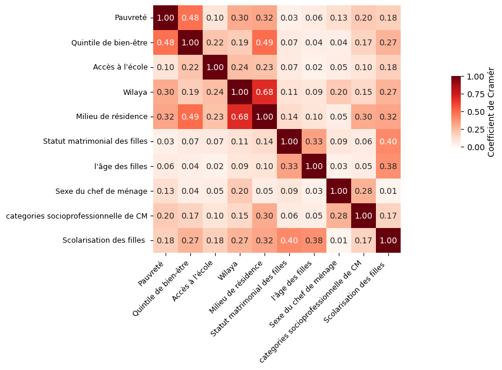
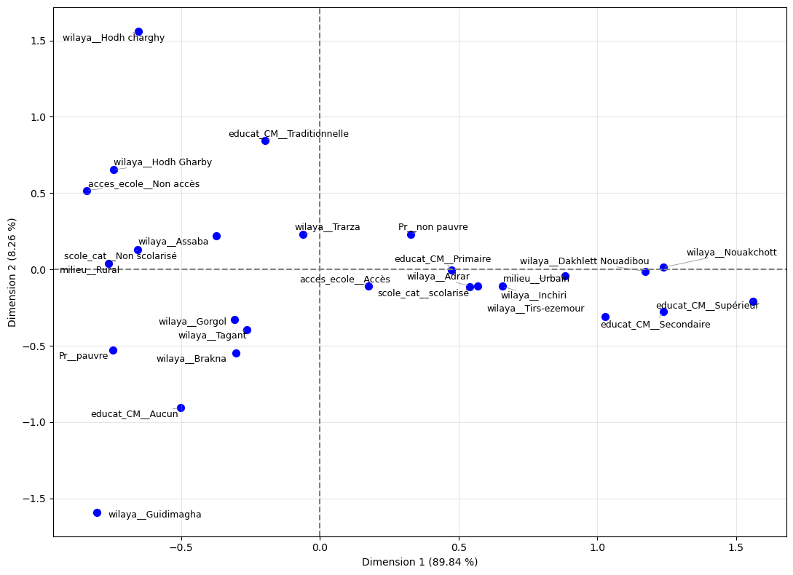
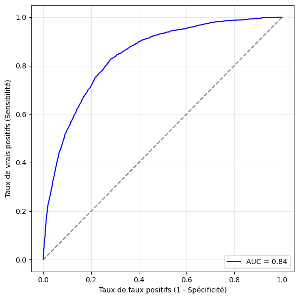

# Non-scolarisation des filles (12–23 ans) en Mauritanie

> Mémoire de fin d'études · Licence professionnelle Statistique et Économie (ISMS) · Stage à l'ANSADE · 2024–2025

**Auteur** : Isselmou Beyah · 🌐 [Site portfolio](https://isselmou-beyah-portfolio.netlify.app) · 💼 [LinkedIn](https://www.linkedin.com/in/isselmou-beyah) · 📄 [Synthèse en une page](rapport/report_1page.pdf) · 📘 [Mémoire complet](rapport/full_report.pdf)

**Question** : quels facteurs sociodémographiques, économiques et géographiques expliquent le risque de non-scolarisation des filles de 12 à 23 ans en Mauritanie ?

| | |
|---|---|
| **Données** | Enquête Permanente sur les Conditions de Vie des ménages (EPCV 2019–2020), 8 045 filles de 12 à 23 ans, données pondérées |
| **Variable cible** | Non scolarisée (1) / Scolarisée (0) |
| **Méthodes** | Statistique descriptive, tests du χ² et V de Cramér, ACM, régression logistique binaire (odds ratios) |
| **Outils** | Python (pandas, matplotlib, seaborn, scipy, prince, geopandas) |

## Résultats clés

- **57,5 %** des filles de 12 à 23 ans ne sont pas scolarisées.
- Principales raisons déclarées : préférence pour l'enseignement coranique / mahadra (**20,1 %**), manque d'école ou éloignement (**16 %**), mariage ou grossesse (**13,6 %**).
- Les facteurs de risque les plus forts sont le **mariage** (OR = 5,22), l'**âge** (19–23 ans vs 12–15 ans : OR = 7,46) et l'**accès difficile à l'école** (OR = 2,51). Vivre en **milieu urbain** réduit fortement le risque (OR = 0,27).
- Le modèle distingue bien les deux groupes : **AUC = 0,84**, exactitude ≈ **75 %**.

## Analyse descriptive

| Situation scolaire des filles | Raisons de non-fréquentation |
|---|---|
|  |  |

| Taux de non-scolarisation par wilaya | Scolarisation selon l'accès à l'école |
|---|---|
|  |  |

## Dépendances et profils (V de Cramér, ACM)

| Matrice des V de Cramér | Analyse des correspondances multiples |
|---|---|
|  |  |

L'ACM oppose deux profils : d'un côté le milieu rural, la pauvreté, l'absence d'accès à l'école et un chef de ménage sans instruction, associés à la non-scolarisation ; de l'autre le milieu urbain, l'accès à l'école et un chef de ménage instruit, associés à la scolarisation.

## Régression logistique

Résultats du modèle (référence entre parenthèses) :

| Variable | Modalité | Odds ratio | p-value |
|---|---|---:|---:|
| Milieu de résidence (rural) | Urbain | 0,27 | < 0,01 |
| Wilaya (groupe 1 : Adrar, Dakhlet Nouadhibou, Brakna, Inchiri) | Groupe 2 : Hodh Ech Chargui, Gorgol, Tiris Zemmour, Trarza | 1,52 | < 0,01 |
| | Groupe 3 : Guidimakha, Tagant, Hodh El Gharbi, Assaba, Nouakchott | 1,36 | < 0,01 |
| Accès à l'école (accès) | Non accès | 2,51 | < 0,01 |
| Éducation du chef de ménage (aucune) | Primaire | 0,55 | < 0,01 |
| | Secondaire | 0,43 | < 0,01 |
| | Supérieur | 0,30 | < 0,01 |
| | Traditionnelle | 0,68 | < 0,01 |
| Pauvreté du ménage (non pauvre) | Pauvre | 1,54 | < 0,01 |
| Catégorie socioprofessionnelle du chef de ménage (employeurs et indépendants) | Précaires / informels | 1,31 | 0,06 |
| | Salariés | 0,75 | 0,01 |
| | Sans travail | 0,96 | 0,50 |
| Statut matrimonial (jamais mariée) | Veuve / divorcée | 4,54 | < 0,01 |
| | Mariée | 5,22 | < 0,01 |
| Âge (12–15 ans) | 16–18 ans | 3,13 | < 0,01 |
| | 19–23 ans | 7,46 | < 0,01 |



Au seuil de 0,5, le modèle atteint une sensibilité de 88 %, une spécificité de 55 %, une précision de 73 % et une exactitude globale de 75 %.

## Contenu du dépôt

```
├── README.md              ← cette page
├── requirements.txt       ← bibliothèques Python nécessaires
├── notebooks/
│   └── analyse_pfe.ipynb  ← analyse descriptive, V de Cramér, ACM, cartes
├── figures/               ← figures présentées ci-dessus
├── rapport/
│   ├── report_1page.pdf   ← synthèse en une page
│   └── full_report.pdf    ← mémoire complet
└── data/
    └── README.md          ← accès aux données (non publiées)
```

## Reproduire l'analyse

```bash
git clone https://github.com/isselmou-beyah/Facteurs-de-non-scolarisation-filles-mauritanie.git
cd Facteurs-de-non-scolarisation-filles-mauritanie
pip install -r requirements.txt
```

1. Obtenir les micro-données EPCV 2019–2020 auprès de l'ANSADE (voir [`data/README.md`](data/README.md)) et les placer dans `data/`.
2. Ouvrir `notebooks/analyse_pfe.ipynb` et exécuter les cellules dans l'ordre.

## Licence

Code sous licence [MIT](LICENSE). Les données EPCV restent la propriété de l'ANSADE.
